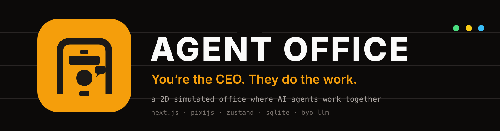
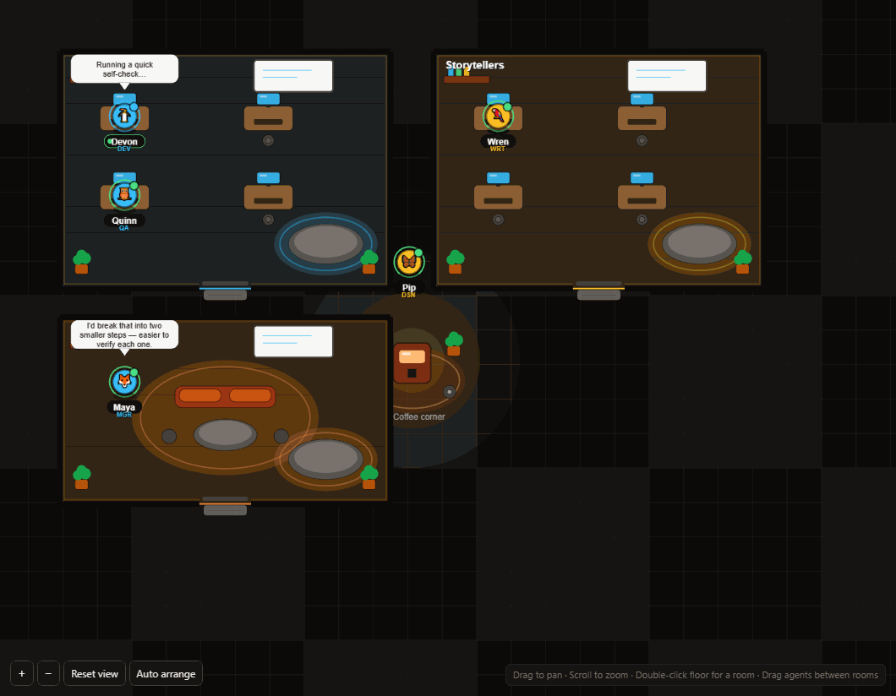
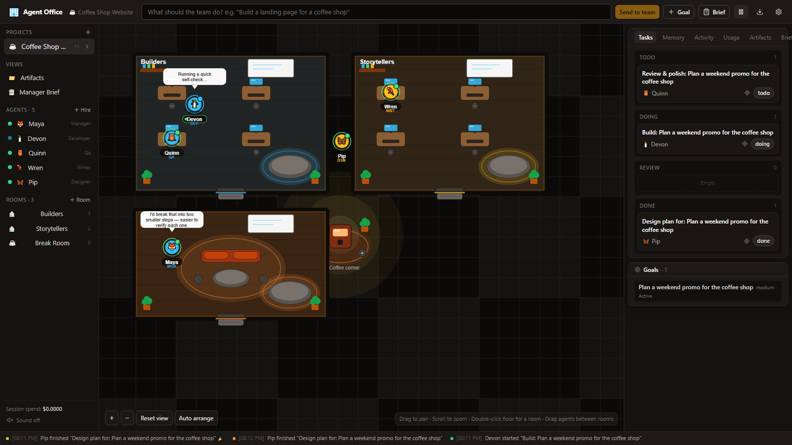
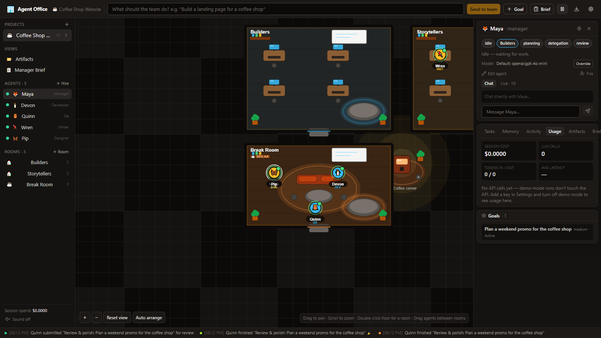
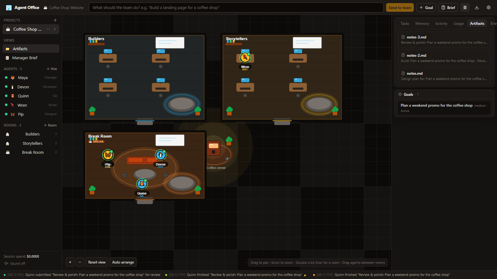
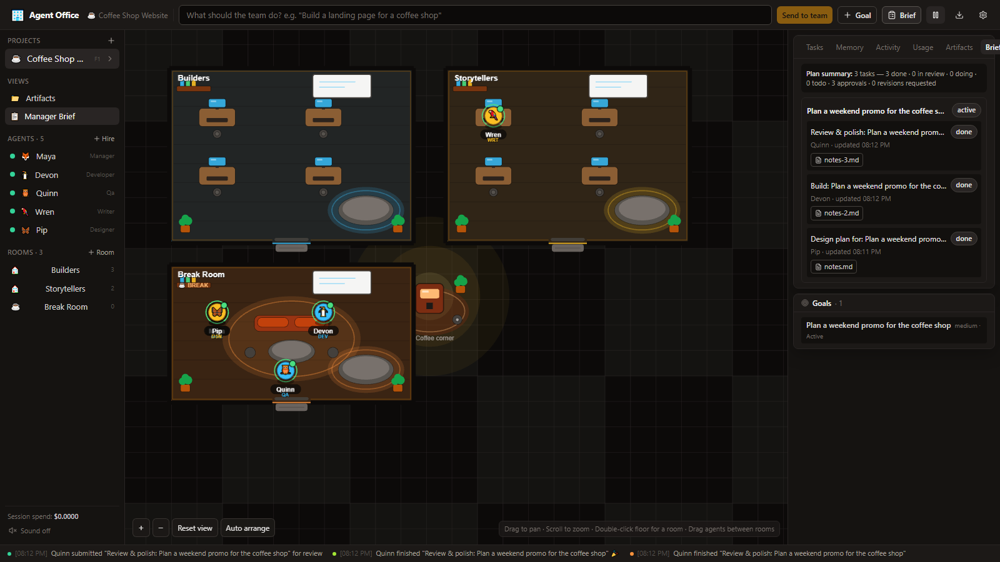
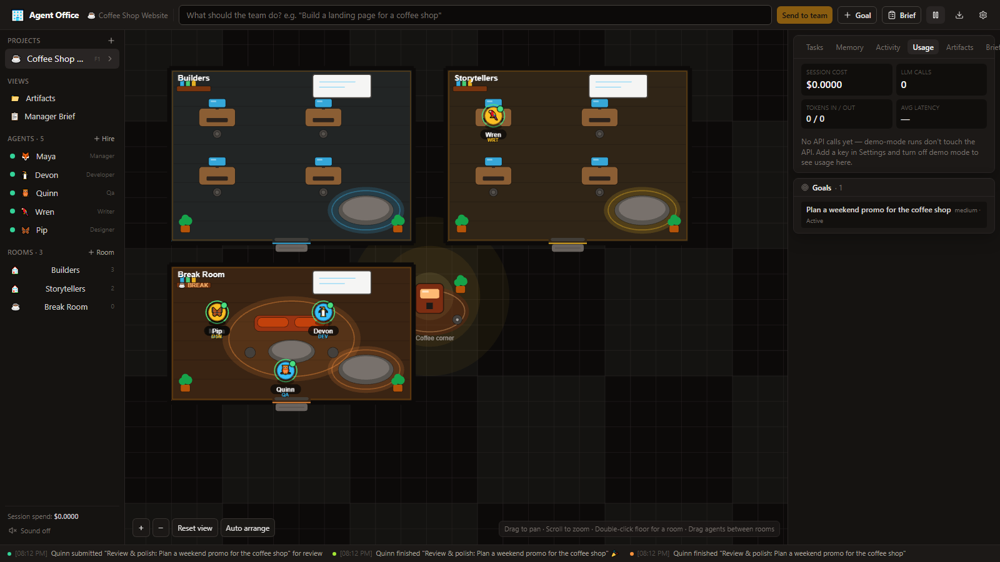
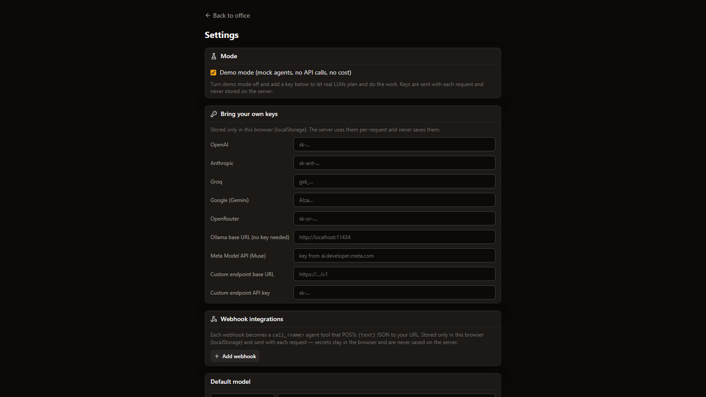
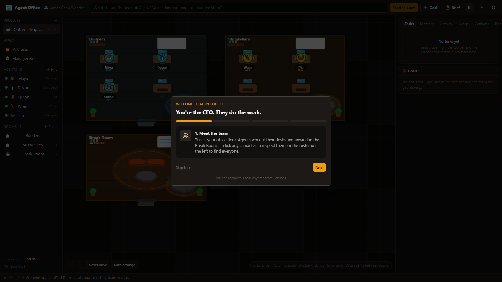
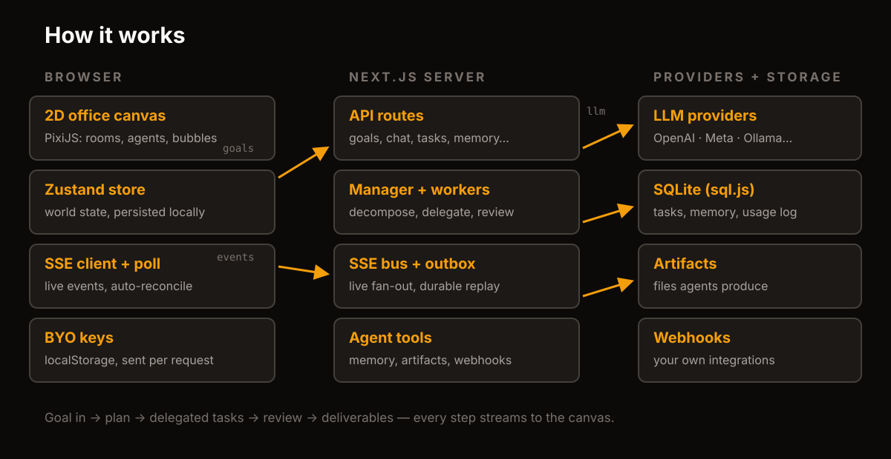

<p align="center">
  
</p>

<p align="center">
  
  
  
  
  
</p>

**Agent Office** is a 2D simulated office where AI agents work together — and you watch it happen. You are the CEO: drop in a goal in plain English, and a Manager agent breaks it down, delegates to specialists by skill, reviews their work, and ships deliverables. All of it unfolds live on the office floor: agents walk to their desks, think out loud in speech bubbles, collaborate desk-to-desk, and unwind in the Break Room when the work is done.

Think *Habbo Hotel meets Linear meets AutoGen*: a delightful watchable surface over a real multi-agent pipeline with memory, tools, review loops, and cost tracking.



*Above: a real run, captured from the app — planning, working, reviewing, celebrating.*

---

## Tour in 60 seconds

**1. Send a goal, watch the plan form.** Type anything into the top bar — *"Build a landing page for a coffee shop"* — and the Manager decomposes it into tasks, assigns each to the best-fit agent, and posts the plan to the team whiteboards.



**2. Follow every agent live.** Click any character for their card: status, skills, current task, model — plus a **Live tab** streaming their thoughts and tool calls as they happen, and direct chat.



**3. Collect the deliverables.** Everything agents produce lands in the **Artifacts workspace**: specs, code, copy, notes — with rendered HTML previews, Markdown, and code views.



**4. Read the brief, check the spend.** The **Manager Brief** shows what each agent was asked to do and what came back; the **Usage dashboard** shows every LLM call, token count, and cost per project, agent, and model.





**5. Bring your own brain.** Settings holds API keys for 8 providers plus any custom OpenAI-compatible endpoint. Keys live in your browser only — the server never stores them. No key? Demo mode runs the whole office on scripted agents for $0.



New here? The first-run tour walks you through it and can fire a sample goal through the real pipeline:



---

## Quickstart

Requirements: Node.js 18+.

```bash
npm install
npm run dev
```

Open [http://localhost:3000](http://localhost:3000) in your browser. The office boots in **demo mode** — send a goal from the top bar and watch the crew work. To use real LLMs, open Settings (gear icon), paste a key, pick a provider + model, and switch demo mode off.

```bash
npm test          # focused suites (agents, bus, store, selectors)
npm run build     # production build
npm start         # serve the production build
```

Everything runs locally except LLM calls. No external database, no Docker, no accounts.

## How it works



1. **Goal in.** `POST /api/goals` stores the goal; the Manager decomposes it (LLM, or a deterministic fallback) and assigns tasks by skill scoring (`lib/agents/delegation.ts`). `@Name` mentions force an assignee.
2. **Delegated work.** Workers run their tasks with role prompts, project-memory context, and tools — streaming thoughts, tool calls, status, and speech over SSE.
3. **Collaboration.** A worker can `ask_teammate`: it walks to their desk and they exchange bubbles (or real LLM replies).
4. **Review loop.** Finished work goes to `review`; the Manager approves or requests revisions (capped, then auto-approved).
5. **Deliverables.** Workers save artifacts; every done task is guaranteed something to open. The Manager writes learnings to long-term memory.
6. **Resilient streaming.** Events fan out live over SSE *and* persist to a SQLite outbox; the client also polls, so drops, restarts, and reconnects self-heal.

## The team

| Role | Does | Signature tools |
| ---- | ---- | --------------- |
| Manager | Plans, delegates, reviews, writes memories | whiteboard, memory |
| Developer | Implements features, specs, code | artifacts, memory |
| Designer | Layouts, visual specs, brand | artifacts, whiteboard |
| Researcher | Gathers and compares options | web_fetch, memory |
| QA | Tests work, verifies edge cases | artifacts, memory |
| Writer | Copy, docs, release notes | artifacts, memory |
| Marketer | Positioning, launch copy | artifacts, memory |

Hire custom agents (name, role, avatar, skills, personality, model, team, home office), edit or fire them anytime. Agents with no explicit model **inherit the system default** — set Muse once in Settings and the whole office follows; override per agent whenever you want.

## Providers and models

Any provider, any model id — the catalog is suggestions; the model field is free-form.

| Provider | Needs | Notes |
| -------- | ----- | ----- |
| OpenAI | API key | `gpt-4o-mini`, `gpt-4o`, … |
| Anthropic | API key | `claude-3-5-sonnet-latest`, … |
| Meta (Muse) | Model API key | `muse-spark-1.3` via `api.meta.ai/v1` |
| Groq | API key | Fast Llama inference |
| Google | API key | Gemini family |
| OpenRouter | API key | Any OpenRouter model id |
| Ollama | Base URL | Local models, no key |
| Custom | Base URL (+ key) | Any OpenAI-compatible endpoint |

Per-agent models are honored end to end: planning runs on the Manager's model, each worker on its own, reviews on the Manager's, teammate replies on the teammate's — all falling back to the system default.

## Memory (3 layers + whiteboard)

- **Short-term** — last messages per task/agent in the store; cleared on completion.
- **Project memory** — decisions, facts, learnings persisted in SQLite with a vector index (keyword today, LanceDB-ready); agents query it via `search_project_memory`.
- **Agent memory** — episodic per-agent learnings from completed tasks.
- **Whiteboards** — one shared board per room; the Manager posts plans, agents read/write via tools, you can view/edit from the room panel.

## API reference

| Route | Purpose |
| ----- | ------- |
| `POST /api/goals` | Create a goal, run Manager → workers pipeline |
| `PATCH /api/tasks/[id]` | Update task status / assignee |
| `GET /api/tasks/[id]/messages` | Task thread (chat, thoughts, reviews) |
| `POST /api/chat` | Chat directly with an agent |
| `GET /api/events` | SSE live stream (replay + live) |
| `GET /api/events/poll?since=` | Reconciliation poll |
| `GET /api/memory` / `?q=` | List / search project memory |
| `GET+POST /api/whiteboard` | Room whiteboard |
| `GET /api/artifacts` · `/api/artifacts/list` | Read / enumerate deliverables |
| `GET /api/report?projectId=` | Markdown project report (downloadable) |
| `GET /api/usage?projectId=` | LLM calls, tokens, cost breakdown |
| `DELETE /api/projects/[id]` | Delete project + server rows |

## Project structure

```
app/                  pages + API routes
components/
  office/             PixiJS canvas: rooms, agents, pathfinding, camera
  panels/             goal input, kanban, agent card, brief, artifacts,
                      usage, memory, rooms, hire, onboarding, toasts
  ui/                 primitives (button, card, dialog, model picker…)
lib/
  llm-provider.ts     multi-provider BYO abstraction (Vercel AI SDK)
  sse-bus.ts          live fan-out + durable SQLite outbox
  agents/             manager, worker, review, collaboration, tools
  memory/             vector store + memory manager
  db/                 Drizzle schema + sql.js client (zero native deps)
  store/              Zustand world + settings stores
hooks/                SSE subscription + poll reconciliation
tests/                node:test suites (run: npm test)
docs/
  assets/             logo, banner, screenshots, GIF, diagrams
  capture.mjs         regenerates every screenshot/GIF from the live app
  make-gif.mjs        assembles the GIF (pure JS, no ffmpeg)
  CAPTURE.md          capture how-to
data/                 local SQLite file + artifacts (gitignored)
```

## Configuration

| Knob | Where | Effect |
| ---- | ----- | ------ |
| API keys | Settings UI (localStorage) | Sent per-request, never stored server-side |
| System default model | Settings UI | Inherited by agents on “Default” |
| `AGENT_OFFICE_DB` | env | SQLite path (tests/scratch DBs) |
| Demo mode | Settings UI | Scripted agents, $0, no network |

## Controls

- **Camera:** drag to pan (works from anywhere), scroll to zoom, double-click floor for a room
- **Agents:** click to inspect/chat, drag between rooms to reassign, fly-to from any task
- **Rooms:** sidebar Rooms section — add, rename, delete, assign home offices
- **Search:** `Cmd/Ctrl+K` across agents, tasks, goals, views
- **Sound:** toggle in the sidebar; celebration on every approval

## Roadmap

- [x] Live 2D office with desks, Break Room, collaboration walks
- [x] Manager plan → delegate → review pipeline with artifacts
- [x] Per-agent live thinking feed + direct chat
- [x] BYO keys: OpenAI, Anthropic, Meta/Muse, Groq, Google, OpenRouter, Ollama, custom
- [x] Memory layers, whiteboards, usage + cost tracking
- [x] Hire/fire/edit agents, rooms management, report export
- [ ] Richer integrations (GitHub, web search keys)
- [ ] Replay/time-lapse mode for a project's day
- [ ] Hosted demo + one-click deploy

## Contributing

Issues and PRs welcome. Keep it green:

```bash
npm test && npx tsc --noEmit && npm run build
```

Store selectors must stay referentially stable (a regression test enforces this), new pure logic ships with a focused test, and README captures regenerate via `docs/CAPTURE.md`.

## License

MIT — see [LICENSE](LICENSE). Brand assets in `docs/assets/` (`logo.svg`, `banner.svg`) are yours to reuse with the project.
